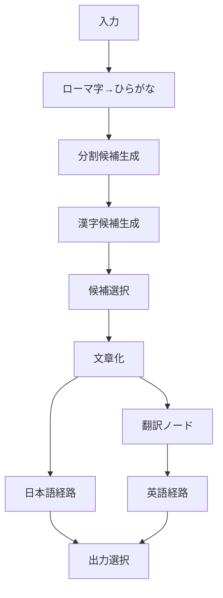

# DIY_IME2 — コア設計仕様 v0.1

- 状態: **初期実装の基準仕様**（実装・試験の完了を意味しない）
- 対象: DIY_IME2 本体が保証する **データ契約、ノードとポートの契約、グラフ実行、エラー伝達、拡張境界**
- 非対象: 個別変換ノードの辞書・アルゴリズム・スコアの算出法、標準ノードの具体的な品揃え、Windows TSF・キー操作の具体仕様、IME 段階で追加するデータ型の具体定義

## 1. 基本原則と責務の境界

1. **ノードで解決できることはノードで解決する。**
2. 実行エンジンは汎用のノード実行基盤とし、IME 専用の変換ロジックを組み込まない。
3. ローマ字から文章への変換を先に扱い、後から IME の操作・Windows TSF 統合を追加する。
4. 日本語入力に閉じず、翻訳、文章校正、独自の文字列処理などをノード追加で実現できる余地を保つ。
5. ノード作者が処理内容・処理範囲・設定・スコア算出・通常のフォールバックを決める。
6. **現段階で固定するのは文章変換用データ形式のみ。** IME 化後のすべてのノード間データを Text / Sequence / Choice に限定しない。機能追加に応じて別の型を設計・導入できる。
7. **当面のIME対応OSはWindowsのみ。** 共通コアは可能な範囲でOS非依存とし、Windows TSFへの接続は独立したアダプターに分離する。他OS版は現段階の開発対象外。

### フェーズごとの規格の適用範囲

| フェーズ | 規格化するデータ | 今決める範囲 |
| --- | --- | --- |
| 文章変換エンジン（現在） | Text / Sequence / Choice を収めた Packet | 文章変換に用いるポートで共有するデータ規格 |
| IME 統合（将来） | 文章変換 Packet に加え、必要に応じたイベント・操作・状態・UI 等の型 | 型そのもの・内容・ポート構成は IME 開発時に検討 |
| LLM／環境連携等（必要時） | ハードウェア情報など、文章に限らないデータ | 利用目的が明確になった時点で検討 |

**将来の追加型の例は採用決定ではない。** 現在のカーソル位置なども、型拡張の可能性を説明する例に過ぎず、実装予定の機能として記録しない。既存の文章変換 Packet の論理形式を維持しつつ、別型のポートを併存させることを許す。

### 本体が担当する

- `Packet` と候補木のデータ型定義・妥当性検査・シリアライズ境界。
- ノード定義の登録、入出力ポート・設定スキーマの宣言、エディターによる接続検査。
- グラフの接続管理、循環検査、依存関係に基づくノード実行、実行 ID による処理の分離。
- 分岐したデータの安全な受け渡し、複数入力の同期、出力なしとエラーの伝達。
- 候補木を走査・再構築する汎用ライブラリの提供。
- 実行時の資源上限と診断の仕組み。

### 本体が担当しない

- 日英判定、ローマ字規則、分割、辞書検索、漢字変換、翻訳、候補評価のアルゴリズム。
- Choice 間のスコア正規化・合算・全文最適化。
- 個別の変換における入力の意味的な正しさの保証。
- 汎用ノード／標準提供ノードの具体的な実装（後続設計）。

## 2. 文章変換用の共通データ構造（初期フェーズ）

**この章は文章・変換候補を受け渡す初期フェーズのポートにだけ適用する。** ノードシステム全体に対する万能データ型ではない。将来追加する別種類の情報を無理に Text / Sequence / Choice に変換する必要はない。

文章変換用ポートは `Packet` を使用し、`root` は次の再帰的な `Candidate` とする。

```ts
type Candidate =
  | {
      type: "text";
      text: string;
      meta?: {
        reading?: string;
        sourceSpan?: [number, number];
      };
    }
  | {
      type: "sequence";
      items: Candidate[];
    }
  | {
      type: "choice";
      options: {
        value: Candidate;
        score?: number;
      }[];
    };

type Packet = {
  version: 1;
  root: Candidate;
};
```

### 意味と不変条件

- **Text**: 文字列の最小単位。`text` は空文字列も表現可能。
- **Sequence**: 子の順序付き連結。子には Text / Sequence / Choice のいずれも置ける。
- **Choice**: 子候補の選択肢。選択肢は `value` と任意の `score` を持つ。
- Text / Sequence / Choice の入れ子順は自由。論理上の深さの上限は設けないが、**循環構造は禁止**する。
- `Sequence.items` と `Choice.options` は空配列も表現可能とする。ただし空の Choice は「候補なし」であって「エラー」ではない。
- `score` は **有限数**、数値が大きいほど優先度が高いものとする。**同一 Choice 内の比較**だけを基本保証とし、確率解釈・Choice をまたぐ比較は保証しない。
- `score` 未設定は正当。スコアの決定・更新・保持・正規化は各ノードが担当する。
- 選択肢が 1 つしかなければ Choice で包むことを強制しない。
- `meta` は任意。`reading` は必要な場合の読み、`sourceSpan` は参照元文字列内の半開区間 `[start,end)`（Unicode コードポイント単位）。参照元を一意に特定できない場合や翻訳等で対応が保てない場合は省略する。位置対応の維持をノードへ一律強制しない。
- **`lang` フィールドはデータに保存しない。** 言語はポート宣言側で接続制約として扱う。「日本語」ポートの中に `30%` や英単語が混ざってもよい。
- 原案の 100% / 85% などは説明上の重みの例であって、実際の確率・採点アルゴリズムを規定しない。

### 例：分割候補の保持

```json
{
  "version": 1,
  "root": {
    "type": "choice",
    "options": [
      {
        "score": 85,
        "value": {
          "type": "sequence",
          "items": [
            {"type": "text", "text": "ほんじつ"},
            {"type": "text", "text": "の"},
            {"type": "text", "text": "こうすいりつ"},
            {"type": "text", "text": "は"},
            {"type": "text", "text": "30%"},
            {"type": "text", "text": "です"}
          ]
        }
      },
      {
        "score": 15,
        "value": {
          "type": "sequence",
          "items": [
            {"type": "text", "text": "ほんじつ"},
            {"type": "text", "text": "の"},
            {"type": "text", "text": "こうすい"},
            {"type": "text", "text": "りつは"},
            {"type": "text", "text": "30%"},
            {"type": "text", "text": "です"}
          ]
        }
      }
    ]
  }
}
```

分割後にノードが各 Text を Choice に置き換えても、元の Choice と Sequence の対応関係を保持できる。

> **設計上の留保:** 大きな候補木の共通部分を重複して保持しない内部表現（DAG、ラティス、遅延評価等）は将来の最適化として許容する。外部に見える論理データの意味は上の形式から変更しない。

## 3. ノード定義とポート

各ノード作者は、少なくとも次を宣言する。

- ノード種別の識別子とバージョン。
- 入力・出力ポートの識別子、データ種別、接続制約。
- 必須入力か任意入力か、および入力が欠けた場合に実行可能か。
- 設定項目（ドロップダウン等）の宣言、初期値、検証方法。
- 入力に対する処理（成功時の出力、出力なし、エラー）。
- 必要なら処理範囲の選択肢（Text 単位 / Sequence 単位 / 候補木全体など）。

### ポートと型

- **初期フェーズの文章変換ポート**は共通の `Packet` による受け渡しを基本とする。新たな機能で必要な別型のポートは、仕様を定義してから追加できる。
- `Packet.version` は現行の**文章変換用 Packet の形式バージョン**を示し、DIY_IME 全体のデータ型体系のバージョンではない。
- 言語ラベルはポートの静的メタデータであり、候補木には付与しない。エディターは宣言された入出力の適合性を検査する。
- 必要に応じて、ポートは受け取り可能な**ルート構造**（Text / Sequence / Choice / Any）も宣言できる。ルート型の制約と、内部に任意の文字が含まれることは別の問題である。
- 異なる言語間の翻訳・変換ノードは、異なる言語ラベルの入出力ポートを持てる。
- 複数の異なる種類の入力を受けるノードは、複数ポートで明示する。接続しただけで暗黙の結合や変換は行わない。
- IME 化などで必要になる制御イベント、UI・状態・環境情報等は、文章候補の Candidate に詰め込むのではなく、**必要に応じて別のポート型**として設計する。詳細や採用の有無は各機能の設計時に決定する。

### 展開（自動走査）方針

展開専用ノードを必須にしない。代わりに、候補木内の Text / Sequence を走査して変換結果を戻す共通ライブラリを提供する。

- 処理対象の選択肢を出すか、どの範囲を扱うかは**ノード作者が決める**。
- ノード作者は補助ライブラリを使わず、候補木全体を直接処理してもよい。
- ノード作者が対応していない処理範囲を、実行エンジンが勝手に拡張・解釈してはならない。
- ライブラリは汎用的な木の走査・再構築を担当し、漢字変換等の意味判断は担当しない。

## 4. グラフ実行規則（初期段階）

1. **DAG（有向非巡回グラフ）**のみ許可し、循環する接続はエディターで拒否する。
2. 依存関係に基づく順序で実行する。実行可能な独立ノードの実際の逐次・並列順序に意味を持たせない。
3. 入力変更時は新しい **実行 ID** を割り当て、別実行の結果が混ざらないようにする。
4. 各ノードは、接続元の入力がその実行 ID で解決済みになった後で実行する。
5. 同じ出力は複数の後続ノードへ分岐可能。データは読み取り専用として共有し、ノードは新しい出力を返す（入力の破壊的変更は禁止）。
6. 一つの入力ポートへの接続は初期仕様では原則 1 本。複数のデータの合流は、**複数入力ポートを持つ合流ノード**等で明示する。
7. 条件分岐で選ばれなかった経路は、データの空文字列や空 Choice とは異なる **NoOutput（出力なし）** として扱う。
8. 複数入力を受けるノードは、接続元の成功・NoOutput・エラーの解決を待つ。必須入力が NoOutput なら原則実行をスキップする。任意入力の NoOutput をどう利用するかはノード側で処理する。
9. エラーは正常な Candidate と区別した実行結果として伝達し、発生ノード・ポート・実行 ID・エラー内容を追跡可能にする。
10. 初期段階から、依存関係解析・ポート検証を含む**実行計画の生成（グラフの事前解析）**を基本とする。キャッシュ・差分再計算・機械語コンパイル／JITは必須としない。入出力の契約を維持したまま将来最適化する。
11. 実行中のグラフ編集を許容し、更新版の検証・実行計画の準備が完了してから**安全な境界で実行計画を切り替える**。検証失敗時は旧版を使い続ける。切替境界のIME固有仕様は後で設計する。

### 実行結果の概念型（Candidate とは別）

```ts
type OutputValue =
  | { status: "data"; packet: Packet }
  | { status: "no-output" };

type NodeRunResult =
  | { status: "ok"; outputs: Record<string, OutputValue> }
  | { status: "error"; code: string; message: string };
```

これは説明用の概念 API。具体的な実行 API や UI 表示方法は後続で確定する。重要な契約は **データ / 出力なし / エラー** を混同しないことである。

### フォールバック

未知語を原文のまま返す、候補を空にする、別辞書へ問い合わせるなどの **正常な処理方針** はノード作者に任せる。処理の失敗（辞書読み込み失敗など）はエラーとして通知できるようにする。

## 5. スコアと候補選択の責務

- スコアの**保存位置**と同一 Choice 内での大小比較だけを共通仕様にする。
- スコアの算出、更新、正規化、選択方法、全文最適化はノードが担当する。
- 初期動作確認には、各 Choice で最大スコアの選択肢を選び、Sequence を連結する単純な選択ノードを使える。ただしこれは**ノード設計の候補**であり本体の固定機能ではない。
- 複数 Choice のスコアを単純に掛け合わせた値を「文章が正しい確率」とみなさない。

## 6. 拡張例（ノード一覧の確定ではない）



翻訳は分割前からも分岐できる。ただし入力の曖昧さや精度はその翻訳ノードの責務とする。出力選択も本体の暗黙動作にはせず、ノード側が決定する。

## 7. あえて現段階では決めないこと

以下は共通仕様との区別を明確にするため **未決定** として残す。

- DIY_IME 本体に不可欠な基盤／システムノードの具体 API・入出力。検討候補：Input（固定文字列／キーボード由来文字列を出力）、Output（print/debug.log 相当の確認・ベンチマーク用）、Spec（CPU/GPU/RAM/VRAM 等の情報取得）、将来の UI（IME 操作・表示）。**Spec のデータ形式と情報取得方法は未定**であり、文章変換用 Candidate に収めることは要求しない。
- [ノード分類の用語定義](node-classification.md)で定義した**プリミティブノード／標準機能ノード／システムノード**に属する、個別ノードの採否・詳細API・提供形態（3分類の**語義そのものは確定済み**）。
- ローマ字変換、分割、漢字変換、SKK、翻訳、文章校正等の各ノードの内部実装。
- キー操作、トリガー、候補確定、Windows TSF 統合など IME 化の詳細、およびその段階で必要になる**追加データ型の有無・構造・互換性ルール**。
- 辞書の具体的なファイル形式・検索API・正式採用辞書、学習方式、スコアの数学的解釈、表示 UI、セキュリティモデル、配布・ロード方式。辞書の基本的な責務分離と候補については[辞書の取り扱い・拡張方針](dictionary-policy.md)に記載する。
- 性能最適化の具体手段（候補削減、ラティス、キャッシュ、コンパイルなど）。

## 8. 次の作業

ノードの3分類については[ノード分類の用語定義](node-classification.md)に共通の語義と境界を記録した。次はシステムノードのホスト境界、およびプリミティブ／標準機能ノードの**個別の採否・仕様・実装**を検討する。

この文書はあくまでコアの契約であり、個別ノードの仕様・採否を先取りしない。

## 9. 開発言語と実行方式の方針（別文書）

本体（Rust）・エディター（TypeScript + React）の初期開発方針、言語非依存ノードAPIの目標、実行中の編集と事前解析済み実行計画の切替については、[開発言語・ノード実行・動的編集方針](technology-and-execution-policy.md) にまとめる。

- 本体と外部ノードの**開発言語は統一不要**。必要なのは共通データ・ポート・実行契約と対応するランタイム。
- WebAssembly／外部プロセスなどの具体的なノードローダーは**将来候補**であり、初期実装に全言語対応を要求しない。
- React Flow、Tauri、Windows TSF接続言語は現時点で**未確定／第一候補**の区別を保つ。
- **OS移植性の方針**: 共通のRustコアとOS固有入力接続を分離するが、macOS・Linux・モバイルOS対応は現時点の目標ではなく動作を保証しない。
