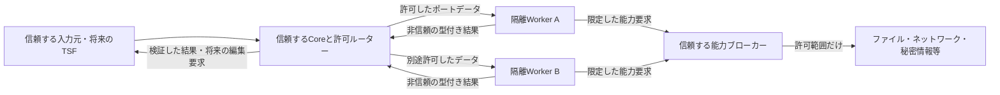

# 第三者ノードの権限・実行隔離・データ境界の提案

状態：**未採用の設計案。製品実装・外部ABI・権限UI・セキュリティ保証ではない。** Issue [#204](https://github.com/pitapa79/DIY_IME2/issues/204)の文書成果物。

ユーザーの既存前提は「Core・TSFアダプター等の本体を信頼する」「ノードに権限の概念を持たせる」の2点。本書の方式・権限名・保存形式・強制方法・導入順はすべて提案で、PRのマージは採用を意味しない。採否判断後に別Issueへ分割する。実行・型・Node・正式fixtureは変更しない。

## 1. 現状と、守るもの

現行のRust組込みNodeは本体と同じプロセスで動く信頼済みコードである。実験35件の登録・検査成功は、悪意あるコードを安全に実行できる証拠ではない。別スレッド、Rustの型、Packet検査、協調取消、共有Hostの予算はOS資源へのアクセスを隔離しない。公開外部ABIもまだない。[現行の実行方針](technology-and-execution-policy.md)と[非同期契約](execution-control-contract-v0.2.md)を維持する。

守る対象は入力本文・周辺文脈・ユーザー辞書・履歴・認証情報、他アプリ/文書/Sessionのデータ、本体のメモリと制御権、OS上のファイル/プロセス/画面、利用者が意図した変換結果である。悪意あるノード作者、侵害された配布元/更新/依存物、偽造・過大・遅延する返信を攻撃者として想定する。署名済みコードや正しい型の返答も意味的には非信頼とする。

OS/kernel、本体、採用したランタイム、ブローカーの実装は信頼の土台になる。これらの欠陥・管理者権限の侵害・物理攻撃を本案で完全に防ぐとはしない。タイミング・資源競合等の隠れた通信も一般に残る。悪意ある作者が正しい形式で誤変換を返すことは、形式検査だけでは判定できない。

## 2. 境界の初期検証案

A/Bは同じ権限空間へ同居させる前提ではない。初期案は、第三者のWasmを小さなimport面と別の隔離Workerで試す二重の境界とし、ネイティブDLLをCore/TSF/対象アプリへ直接ロードしない。軽い信頼済み組込みNodeは既存経路を維持する。Python等は後続のOS隔離Host候補で、Wasmへ変換できることを必須にしない。巨大なIME・LLM・複数モデルを一律禁止しない。

### 方式比較（採用結果ではない）

|方式|期待できる分離|追加で必要なもの・弱点|本案での位置|
|---|---|---|---|
|Rust組込/同一プロセスDLL|本体が信頼するコードとして低い配送コスト|任意OSアクセスと本体メモリを同じ権限で扱える。宣言だけで制限できない|信頼済み組込だけ|
|別スレッド/同じ利用者権限の別プロセス|クラッシュや実行時間の管理を分けやすい|利用者のファイル等への権限は残る。十分なセキュリティ隔離と扱わない|単独では非信頼コードへ使わない|
|同一プロセス内Wasm|検査した線形メモリとimport/exportを通じた境界|Host関数・ランタイム/JITの不備は本体側へ影響し得る|代替案。低遅延の利点と被害域を比較|
|Wasm + OS隔離Worker|言語実行とOS権限を重ねて分離できる可能性|起動/IPC/コピー、コンパイル・RAM管理、OS互換性の検証が必要|初期検証の推奨案|
|OS隔離したネイティブ外部Host|既存の多言語/NLPライブラリを利用しやすい|Pythonの拡張DLLも含めOSが制限する必要。GPU/COM等は範囲を広げる|必要機能ごとの後続候補|
|VM等のさらに強い境界|OS境界自体の被害域を分ける選択肢|対応OS機能/起動/メモリ/配送遅延が制約。IMEの常用に適するか未測定|高い隔離を必要とする構成の代替案|

WasmのI/Oはリンクしたimport等を通るため、Host側が何を渡すかが境界になる。WasmtimeのWASIは能力ベースのファイルアクセスを説明しているが、任意のHost関数の安全性を自動保証するものではない。[Wasmtime Security](https://docs.wasmtime.dev/security.html)

Windowsでは、AppContainerによる資源アクセス制約と、Job Objectによるプロセス群・予算・終了管理を別に設計する。AppContainerにも読み取りや共有資源の許可範囲があり、「全OS機能を既定で遮断する箱」と推測しない。LPACやWin32k制限等を含め、必要な拒否を実測できない組合せは非信頼Nodeの起動を拒否する案とする。[AppContainer isolation](https://learn.microsoft.com/en-us/windows/win32/secauthz/appcontainer-isolation)、[Job Objects](https://learn.microsoft.com/en-us/windows/win32/procthread/job-objects)

AppContainerのprofile APIはWindows 8以降のdesktop APIだが、**新しいWin32 app isolation機能はWindows 11 24H2以降を要件とする別の候補**である。後者の資料には非対応OSでFullTrustへ戻る挙動も記載される。本案ではWindows 10で無制限実行へ自動移行するfallbackを認めず、対応可能な境界を別途検証する。APIの存在は安全な構成の検証結果ではない。[CreateAppContainerProfile](https://learn.microsoft.com/en-us/windows/win32/api/userenv/nf-userenv-createappcontainerprofile)、[Win32 app isolation要件](https://learn.microsoft.com/en-us/windows/win32/secauthz/app-isolation-overview)、[release notes](https://learn.microsoft.com/en-us/windows/win32/secauthz/app-isolation-release-notes)

## 3. 権限の宣言・許可・強制を分ける

概念上、実行するpackage内容のhash・バージョン・Node種別・利用者・許可改訂・計画/Sessionの範囲を主体へ束縛する。正確なID/manifest/wire形式は未定。Nodeが送った自己申告のpackage名やPIDだけで認証しない。権限は「要求する宣言」「利用者が許可した範囲」「OS/Hostが現在強制している範囲」の積として扱い、既定拒否を提案する。

|能力の例（名称未定）|限定する対象|強制する責務|
|---|---|---|
|渡されたポートデータ|そのjobへ許可した値だけ|Coreが最小のsnapshotを投影。Registry/計画全体/他Node設定を渡さない|
|入力・周辺文脈|アプリ/文書/選択範囲/世代・必要な長さ|信頼する入力アダプターとブローカー。全Nodeへ全文を暗黙注入しない|
|辞書等の読取|明示したファイル/範囲/不変snapshot|Hostが実対象を検査してバイト列等を渡す。Nodeは構文/検索を担当|
|保存・書込|Node専用領域、操作/容量/保持範囲|Host/OS。利用者の辞書・文書を専用cacheと混同しない|
|ネットワーク|接続先、方法、送信可能な由来、サイズ/期間|接続ブローカーとOSの直接通信拒否。URL文字列の検査だけで終えない|
|外部API・認証|provider/action/accountの限定|秘密を持つ信頼ブローカー。鍵は環境変数・Graph JSON・Nodeへ配らない案|
|クリップボード・入力機器|読取/書込/明示した操作時だけ|OS/入力ブローカー。全体監視や他窓のHookを一般能力としない|
|プロセス起動・ネイティブ拡張|明示した必要性と実行物|初期案では第三者Nodeへ渡さない。必要なら別の採否・隔離単位|
|時計・乱数・GPU等|必要な観測/資源と副作用|専用Host面。高精度時計、GPUサービス、共有メモリの影響を別検証|
|診断・ログ|サイズ/出力先/機密性|Hostが制限して安全な文字列として表示。入力履歴の保存は既定にしない|

既存RunContext/OwnedInvocationに含まれる入力や計画参照を、そのまま外部へserializeしない。セッションID・RunKey・CauseIdは照合用識別子で、知っているだけでアクセスを許す資格ではない。現在のbroker-v3/loopback HTTPを外部Nodeへ公開する案ではなく、Nodeに必要な小さな別の能力面を検討する。

OS隔離Workerは環境変数・秘密・作業ディレクトリ・ハンドルを丸ごと継承しない。ブローカーが許可するchannelを起動主体へ束縛し、他Nodeのpipe・共有メモリ・本体の管理APIへ横から接続できないことを検査する。AppContainerの共用読み取り権限、COM/RPC、loopback等も試験対象に含める。

ファイルは単純な文字列prefixやcanonicalize後の再openで境界を証明しない。実際に開いた対象の同一性と許可範囲を確認してから内容を渡す解決器が必要で、`..`、UNC、device/ADS、大小文字、junction/linkの差し替えを含むWindows固有検証を別Issueで行う案とする。ネットワークもDNS解決先、再解決、redirect、proxy、IPv6/loopback/内部宛を各段で再確認する。Nodeへの無制限なファイルhandle/socketの譲渡は初期案に含めない。

WASIの環境・stdio・networkの継承は明示的なAPI面にある。本案は採用ランタイムの既定値に依存せず、許可しない面を明示して構成し、Nodeの宣言と実際の能力がずれないことを確認する。[WasiCtxBuilder](https://docs.wasmtime.dev/api/wasmtime_wasi/struct.WasiCtxBuilder.html)

## 4. 接続できることと、外へ送れることを分ける

例えばAが入力を読めて通信できず、Bが通信できて入力文脈の直接読取を持たなくても、A→Bというポート接続で内容が外へ送られ得る。B単体の権限確認だけでは防げない。型/言語が合うことも送信許可の証明ではない。

|代替案|利点|限界・初期案|
|---|---|---|
|package単位の権限一覧だけ|説明が単純|間接転送を利用者が把握しにくい。単独では不採用を提案|
|グラフ全体を信頼して一括許可|利用者が意図した外部利用を広く許せる|小さな追加でも広い漏出経路が生まれる。明示した上級選択肢なら検討可能|
|信頼するHostの由来ラベルと送信先検査|外へ出るデータの由来と宛先を組合せて説明できる|状態/cache/制御依存まで追う設計が必要。初期案の推奨|

推奨案では、Hostが入力元・ファイル・文脈・設定・過去状態等の由来をNodeの出力へ保守的に合成する。Node自身が「匿名」「公開」と自己申告してラベルを落とすことは許さない。Error/NoOutput・診断・選択条件・長さへ符号化する可能性も含め、ある入力を読んだNodeの出力を本文だけに限定して追跡しない。利用者が許可した由来→宛先の組合せをブローカーでも検査する。

ただしこれは一般的な情報流の完全証明ではなく、タイミング等の隠れた通信を解決したとは扱わない。厳格な機密性を要する構成では外向き通信や共有状態を持たない実行域へ分ける案も提示する。復旧/代替/他Node経由でも由来を消さず、変換したから安全と推定しない。匿名化で許可を緩める機能は信頼する専用判断として別途採否を決める。

グラフの追加・更新で送信先や由来が増えた場合、旧グラフへの許可を黙って拡張しない。準備時に差分を示し、許可が足りない新計画は稼働させず旧計画を保持する案。明示した全入力の外部API利用は可能にし、キーごとの承認画面を強制する案にはしない。ラベル/許可の保存やUIの粒度は未決定である。

Node専用の状態・cacheもデータの出入口である。主体/由来/許可改訂を確認して分離し、同名ファイル・同じpackage・同じhashだけで別利用者/文書の内容を再利用しない。安全に共有できる不変資源は、各主体の現在の許可を確認した場合にだけ共有する案とする。

## 5. 入出力・編集・診断の扱い

- 返信は非信頼bytesとして上限を確認してから解釈し、版・型・長さ・UTF-8・Packet構造・安全な整数・有限スコア・所有channel・epoch/plan/run/input/job/配送世代を確認する。正しいJSONであることと、採用可能であることを分ける。
- 外部Nodeの「完了」メッセージから任意の内部CompletionPermitを作らせない。信頼するadapterが自分の仕事との束縛と真正な終了条件を確認する。古い結果は採用せず、真正な旧終了は回収に使える既存契約を保持する。
- 文章Packetは文章データとして扱う。文字列をshell/HTML/script/Windows APIの命令として実行しない。診断もANSI制御等を無害な表記にし、Nodeによるログを本体の確定判断に見せない。Wasmのoffset/lengthは演算overflowとmemory境界を確認し、生のHost pointerを渡さない。認証情報や入力本文を既定の監査ログへ保存しない。
- 将来のOS編集要求は、文章Packetと別の正式型/権限へ分ける案。信頼するTSF側が対象アプリ/文書/編集範囲/改訂/フォーカス/利用者操作との対応を確認する。古い選択範囲、別文書、UTF-16境界の途中、任意window handleへの操作を拒否する。現行の[UTF-16検査例](windows-text-boundaries.md)は公開OS編集APIではない。
- 認可失敗・sandbox破損・transport故障を通常のNode変換エラーへ一律に偽装し、別Nodeへのfallbackで無許可操作を通さない。既存のNode失敗・復旧記録との分類は別契約で確定する。

## 6. 許可の撤回・更新・配布

許可の撤回/期限切れは、Hostの信頼する時計と許可改訂を基準に、新たな能力要求を止める。待機中/受付済み操作、返信・結果採用でも現在の許可を再確認し、旧許可をrollbackで復活させない。動作中の計画へ許可の改訂を反映させる経路が必要で、計画を不変にしただけでは撤回を実現できない。

実行の取消・プロセスの停止・送信した情報の回収は別である。既に外へ送った内容や外部APIの副作用は、取消/撤回で取り消せない。成功した外部操作を結果不明のまま自動再送しない。秘密が外部コードへ渡った場合の漏出は、ローカル許可の削除だけで解消したとはしない。

配布ではpackageと依存物・実行物をhashで固定し、配布元/署名/検査結果/要求能力を利用者が追跡できる案を示す。署名は出所/改ざんの手掛かりで、善意や安全性の証明ではない。インストールスクリプト・dependency解決・初回コンパイルもコード実行として扱い、利用者権限で黙って動かさない。更新で能力やバイナリが変われば再評価し、旧承認を自動流用しない。署名方式・trust store・失効配布は未選定。

アンインストールはまず新受理と許可を失効させ、残存仕事/資源の所有を確認する。共有辞書や利用者の入力履歴をNode専用cacheと一括削除しない。保存データの削除・保持は別の利用者選択とする。

AOT/cacheを使う場合も、外部提供の任意bytesを「検査済みWasm」としてdeserializeしない。Wasmtimeのcompiled module復元APIは信頼済み生成物を前提とするunsafe APIである。信頼するコンパイル経路・改ざん防止・runtime版/設定/元Wasm hashの束縛が必要な案で、AOTの採用は未決定。[Module::deserialize](https://docs.wasmtime.dev/api/wasmtime/struct.Module.html#method.deserialize)

## 7. 非同期・資源・終了の境界

現行の共有resourceDomain、明示ResourcePolicy、保持/重複排除/キュー、論理終端と物理数、producer終了とcallback復帰の分離は再利用できる。一方、任意のNative CPU/一時ヒープ、OS権限、子孫プロセス、GPU/外部サービスの仕事は現契約では隔離しない。[P1の限界](execution-p1-handoff.md)を変更せず、外部adapterの終了証明と予算を別途設計する。

Wasmのfuel/epochはguest実行の制御候補だが、ブロックしたHost呼出しを止める機能ではない。メモリの上限も1つの線形メモリ単位等の設定と、Host/JIT/合計RAMの上限を分ける。具体的な上限値や必須run期限は本案で追加しない。[Wasmtime Config](https://docs.wasmtime.dev/api/wasmtime/struct.Config.html)、[StoreLimitsBuilder](https://docs.wasmtime.dev/api/wasmtime/struct.StoreLimitsBuilder.html)

Job Objectだけで権限を減らせるとはしない。起動前に必要な制約を確定し、許可していないbreakawayや別のOS起動サービス経由の脱出も検査する。将来の強制停止は、対象の隔離単位・子孫・プロセスhandle・残るI/O/Host callback等を確認してから回収する。Job通知1つやguestのdoneだけを全終了の証明にしない。

特に非信頼Nativeの常駐プロセスは、返答後も別threadで仕事を続け得る。初期試作では1呼出しの隔離単位を明確にし、必要ならその単位の真正なプロセス終了までleaseを保持する。pool再利用/プロセス予算とjob予算の分離は、測定と追加所有契約の判断後にする。Wasmでも信頼するruntimeがguest実行終了と全Host操作の回収を確認する。

強制停止で共有Core/別Sessionまでkillする経路を作らず、停止確認不能は未確認のまま資源を保持する。外部サービス/ドライバーに移った仕事をprocess終了だけで完了扱いにしない。故障後の自動Host置換で予算や許可をリセットしない。新方式を組み込む前に、既存の物理仕事の意味を満たすadapterまたは別の明示契約が必要である。

## 8. 性能と互換性を検証する順序

モジュール検査・コンパイル・許可確認・資源準備を入力のたびに行う前提にしない。長時間の許可ダイアログも入力経路へ直結させない。準備/起動、IPC/コピー、Core配送、Node処理、TSF反映を別測定し、cold/warm、P95/P99、失敗/拒否/回収時間を記録する。[性能目標](performance-goals.md)のReference IME LatencyとCore Overheadを、ブラウザー往復や小辞書の値へ読み替えない。

Wasm import/Component/WIT、OS brokerのwire、permission保存形式は未選定。既存Graph/Packet/RunContext、同期v2・明示v3を黙って外部ABIへ転用せず、旧clientが権限を強制できない新グラフを成功扱いにしない。外部adapterだけの明示capability/版が必要かを採用時に決める。

現在のRust 1.90 GNU・Windows 10/11 x64とのビルド/ランタイム互換は未検証で、ランタイムの版やMSRV変更も別判断。Microsoft資料とWasmtimeの公開文書は2026-10-30に確認した。参照APIには51.0.0-devの表示があり、その版を採用・検証したという意味ではない。

## 9. 後続へ切り出せる受け入れ試験案

以下は期待結果の提案で、テストNode/隔離Hostの実装も実行も本Issueに含まない。自分で作ったcanaryファイル・制御サーバー・偽文書だけを使い、実ユーザーの秘密やインターネット送信を試験データにしない。

|ID|失敗例/正常例|期待結果と観測する証拠|
|---|---|---|
|S01|無許可のファイル読取|canary本文を取得できず、Node/ログ/返信に現れない。許可前に読まない|
|S02|`..`/prefix衝突/UNC/ADS/device/link差し替え|許可範囲外の実対象へ到達せず、対象同一性を検査できない場合も拒否|
|S03|読取許可で書込/削除|canaryのhashが不変。OSへの直接アクセスも拒否|
|S04|無許可TCP/UDP/DNS/IPv6/loopback|制御先で受信0、名前解決やproxy等の迂回も検査。管理HTTPへ直結しない|
|S05|shell/子孫/COM/WMI等で起動を依頼|未許可の新プロセスや高権限broker操作が発生しない。Jobだけに依存しない|
|S06|別Node/Sessionのpipe・memory・cache参照|他主体のcanaryを観測できず、共有は双方の現在許可が必要|
|S07|Node名/PID/RunKey/許可改訂の偽装|起動時に束縛した主体で検査し、別主体や古い許可で成功しない|
|S08|環境/継承handle/鍵/Crash dumpから秘密を取得|未許可情報が渡らない。API鍵は許可した操作でもNodeへ露出しない|
|S09|他窓のclipboard/入力Hook/文書/画面参照|許可のない面を実OSでも拒否。強制できないHostは起動を拒否|
|S10|入力を読むA→通信可能Bへ転送|由来→宛先の許可なしでは送信0。本文/metadata/診断/制御依存も対象|
|S11|復旧Node/cache/状態を介して由来を落とす|Nodeの自己申告でラベルが弱まらず、別利用者へ状態を再利用しない|
|S12|グラフ編集で送信経路を追加|旧承認を拡張せず新計画の差分を示す。旧計画と状態を壊さない|
|S13|許可した送信先からredirect/再解決で外へ迂回|各段の宛先/方法/由来を再検査し、許可外の受信0|
|S14|受付後の権限撤回/期限切れ/rollback|新能力要求と旧結果採用を拒否。旧計画へ戻しても旧許可を復活させない|
|S15|送信済みのAPI操作を取消|新規送信/再送は止まるが、既に制御先で成立した1操作を0と報告しない|
|S16|不正/過大Packet・reply・u64/遅延旧世代|有界な読取と検査で拒否し、本体と他Sessionが生存。古いDataを採用しない|
|S17|別文書/古い改訂/UTF-16途中の編集命令|偽文書の内容・範囲が不変。文章PacketをOS操作へ解釈しない|
|S18|ANSI/HTML/scriptや秘密入り診断|表示で制御を実行せず、機密を既定ログへ保存しない。拒否自体の漏出も点検|
|S19|無限Wasm/巨大module/過剰memory/table/Host割当|選んだ資源設定で制御。1memory上限と合計RAM/JITを混同しない|
|S20|ブロックHost call/Native非協調/偽done|論理取消と物理終了を分離し、真の回収まで枠保持。返答だけで次を無制限起動しない|
|S21|Jobからの脱出/子孫生存/外部サービス仕事|終了を全て確認できなければ未確認を表示し、根Hostを自動置換しない|
|S22|更新で能力追加/hash変更/依存install script|新しい承認/検査なしに実行しない。署名だけを安全判定にしない|
|S23|偽造AOT/cache・runtime版違い|非信頼bytesをcompiled moduleとして復元しない。適合/整合を検査|
|S24|アンインストール/許可削除後の残存仕事|新受理を止め、真正な終了を待つ。共有辞書や他Nodeのデータを消さない|
|S25|許可した純粋変換・辞書読取・外部API|正常処理が成功し、許可した範囲のデータだけ往復する。全拒否で合格にしない|
|S26|Windows 10/11の版・機能差|各OSの成功/非対応を別記録。非対応でFullTrustへ黙ってfallbackしない|

## 10. 段階導入案と、残る採否

1. ユーザーが脅威範囲・初期方式・許可粒度・隠れた通信の扱いを選ぶ。本書だけで確定しない。
2. 採用範囲だけを別Issueの正式契約/fixtureにする。偽Hostで主体・由来・撤回・旧世代の拒否を検査する。
3. 1つの小さなWasmと能力なしWorkerでOS/言語境界・CPU/RAM・真正な終了を検証する。対応OSを別々に実測する。
4. 明示的な読取資源からブローカーを追加し、許可した正常経路と拒否を両方確認する。現行の[準備済み資源案](prepared-node-resources-proposal.md)も未採用の依存として比較する。
5. 送信先と由来の許可が成立してからnetwork/API/秘密管理を追加する。広いNative/GPU Hostや配布/update/権限UIは、それぞれ別の採否・検証を経る。
6. TSFの信頼する編集境界と実IME性能を最後に統合する。Coreは変換/辞書/選択の意味を取り込まず、ノードの交換可能性を維持する。

未決定は実行runtime/版、AppContainer等の具体構成、隔離方式ごとのOS対応可否（現行Windows 10/11の対象方針は変更しない）、権限ID/保存/UI/撤回範囲、送信の由来と暗黙依存、pool/GPU所有、配布元/署名/失効、監査の保持、公開ABI、性能の合格条件である。未解決事項を実装済みの保護として説明しない。

## 11. このIssueで実施した確認・戻し方

現行資料/コードの境界、公式資料、Issue完了条件の対応、ローカル文書リンク・Mermaidソース・差分を確認した。新しいbuild/test、sandboxの実機検査、攻撃Nodeの実行、性能測定、独立レビューは行っていない。直前mainのRust614/editor195件を本セキュリティ案の実証へ流用しない。

変更対象は本提案書とHANDOFFの作業記録だけ。戻す場合は文書差分をrevertする。既存の正式契約・権限・OS設定は変わらない。提案書のPRをマージしても製品のセキュリティ機能が有効になったとは扱わず、採用前に実装Issueを自動作成しない。
