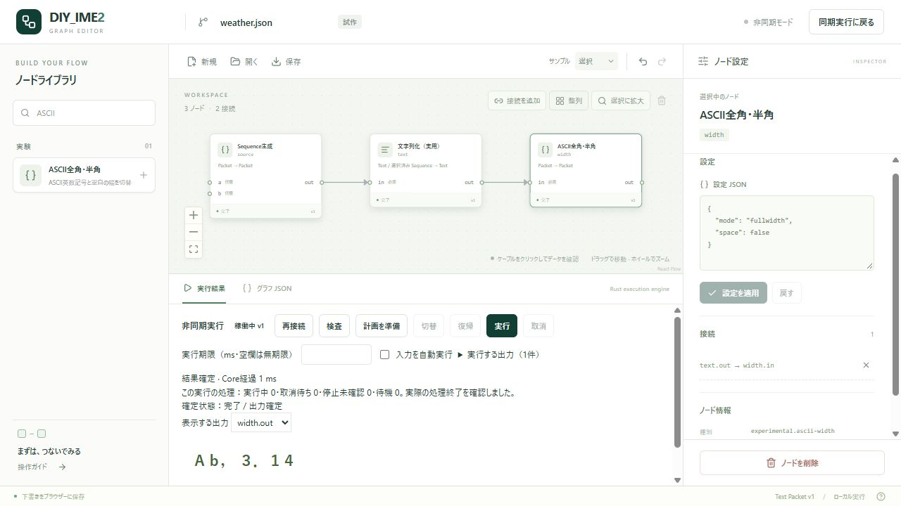

# 旧35実験ノードの案内

この一覧はNode分離前に画面へ登録した35種の記録です。現行の配布版では処理ノードを公式Wasmパッケージとして導入します。使い方と現在の構成は [Windows配布アプリ](security/windows-application-distribution.md) と [Node分離の移行台帳](node-repository-migration.md) を参照してください。

各ノードのガイドには、設定や入出力、契約例があります。現在の互換性検査は、同梱Wasmの定義、保存済みグラフ、辞書入力、Data・NoOutput・Errorを対象とします。

- [大文字・小文字変換](../examples/nodes/text_case/README.md)
- [空白除去](../examples/nodes/text_trim/README.md)
- [連続空白整理](../examples/nodes/whitespace_collapse/README.md)
- [改行処理](../examples/nodes/line_endings/README.md)
- [文字列抽出](../examples/nodes/text_extract/README.md)
- [前方抽出](../examples/nodes/text_prefix/README.md)
- [後方抽出](../examples/nodes/text_suffix/README.md)
- [文字種フィルター](../examples/nodes/character_filter/README.md)
- [エスケープ・復元](../examples/nodes/json_escape/README.md)
- [ひらがな→カタカナ](../examples/nodes/hiragana_katakana/README.md)
- [カタカナ→ひらがな](../examples/nodes/katakana_hiragana/README.md)
- [文字列置換](../examples/nodes/text_replace/README.md)
- [文字列分割](../examples/nodes/text_split/README.md)
- [重複候補削除](../examples/nodes/choice_deduplicate/README.md)
- [文字列連結](../examples/nodes/text_concat/README.md)
- [文分割](../examples/nodes/sentence_split/README.md)
- [全角・半角変換](../examples/nodes/ascii_width/README.md)
- [句読点変換](../examples/nodes/japanese_punctuation/README.md)
- [上位N件抽出](../examples/nodes/choice_top_n/README.md)
- [候補並べ替え](../examples/nodes/choice_sort/README.md)
- [候補数制限](../examples/nodes/choice_limit/README.md)
- [スコア閾値フィルター](../examples/nodes/choice_threshold/README.md)
- [候補削除](../examples/nodes/choice_remove/README.md)
- [スコア付与](../examples/nodes/score_set/README.md)
- [スコア加算](../examples/nodes/score_add/README.md)
- [スコア乗算](../examples/nodes/score_multiply/README.md)
- [スコア正規化](../examples/nodes/score_normalize/README.md)
- [Choice展開](../examples/nodes/choice_extract/README.md)
- [Sequence展開](../examples/nodes/sequence_extract/README.md)
- [パススルー](../examples/nodes/packet_passthrough/README.md)
- [候補木の深さ制限](../examples/nodes/packet_depth_limit/README.md)
- [候補木再構築](../examples/nodes/packet_rebuild/README.md)
- [Choice生成](../examples/nodes/choice_build/README.md)
- [候補統合](../examples/nodes/choice_merge/README.md)
- [Sequence生成](../examples/nodes/sequence_build/README.md)
