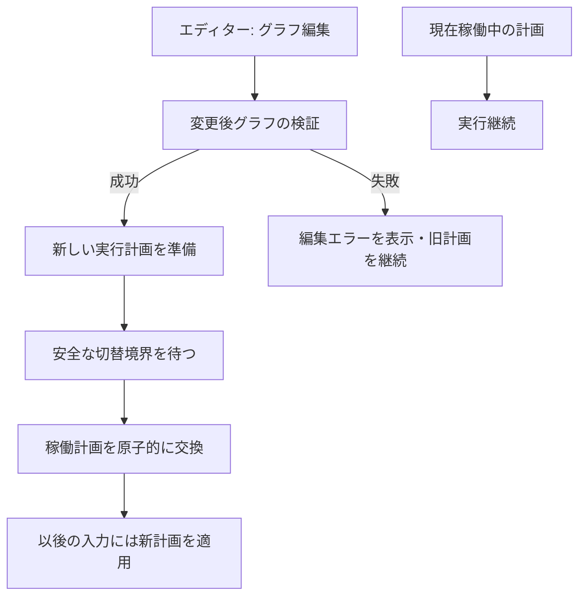

# DIY_IME2 — 開発言語・ノード実行・動的編集方針

- 状態: **現時点の設計方針**（実装・検証済みを意味しない）
- 対象: 本体とエディターの言語、ノードの多言語対応方針、グラフの編集／実行方式、対応OSとOS接続の分離
- 関連: [コア設計仕様 v0.1](core-architecture-v0.1.md)、[汎用ノード候補](generic-node-candidates.md)
- 前提: まず文章変換エンジンを作り、Windows IME は後続段階で開発する。

## 1. 技術選定の結論と確定度

| 対象 | 現時点の方針 | ステータス |
| --- | --- | --- |
| 文章変換・グラフ実行エンジン（本体） | **Rust** | **初期開発の採用方針** |
| 最初に実装する内蔵ノード | **Rust** | **初期開発の採用方針**。外部作者には強制しない |
| ノードエディターの UI | **TypeScript + React** | **初期開発の採用方針** |
| ノード接続を描画・編集する UI ライブラリ | **React Flow** | **第一候補**。実装前に要検証 |
| デスクトップアプリ構成 | **Tauri** | **第一候補**。採用最終判断は試作後 |
| 対応OS | **Windowsのみを当面の開発対象とする** | **現時点の開発方針**。他OS版IMEは開発目標に含めない |
| コアエンジンとOS接続 | **コアは可能な範囲でOS非依存、OS入力機構は独立したアダプター** | **設計方針**。将来の移植を保証するものではない |
| Windows TSF 接続 | **Rust または C++** | **未決定**。Windows/COM 相互運用を試作して決定 |
| 外部作者のノード言語 | **本体言語とは独立した複数言語に対応する設計** | **設計方針**。個々の言語のサポートはアダプター実装・検証後 |
| 多言語ノードの実行 | **WebAssembly と外部プロセス通信を主要候補** | **方式の候補**。両方の実装を初期段階で必須としない |
| 実行中のグラフ編集 | **許可する** | **目標とする基本動作** |
| グラフの実行 | **検証済みの実行計画を生成して実行** | **採用方針**。機械語コンパイルは必須でない |
| 稼働中の設定切替 | **新計画の準備完了後、安全な境界で切替** | **採用方針**。境界の詳細はIME段階で定義 |

「初期開発の採用方針」は当面の作業の基準であり、性能・互換性の検証結果に応じて改訂できる。「第一候補」と「未決定」を勝手に採用済みとして扱わない。

## 2. 本体とノードの言語を一致させる必要はない

**統一するのはプログラミング言語ではなく、ノード API・データ／ポート型・実行規約である。**

- Rustで書かれた本体が、Rust以外の言語のノードも扱える構造を目指す。
- 各ノードは言語に関係なく、宣言されたポート、設定、入出力結果、エラーなどの契約に従う。
- 現在の文章変換ポートは `Packet`（`Text / Sequence / Choice`）を用いる。IME段階にはイベント・状態・UI等の別型を追加できる。
- 言語ラベル（例: 日本語ポート／英語ポート）はポート宣言で扱い、文章 Packet 内の `lang` は設けない。
- 本体がその言語の **ランタイム／アダプター／通信方式を提供している場合に限り**ノードを実行できる。「あらゆる言語が何の準備もなく動く」とは保証しない。
- 言語・実行方式によって実行性能、GPU利用、OSアクセス、ライブラリ互換性、権限は異なりうる。
- **外部ノードの追加のために本体を再ビルドしなくてもよい設計**を目標とする（採用する拡張方式での検証が必要）。

### 2.1 想定する実行方式

| 方式 | 用途・利点 | 注意点 | 時期 |
| --- | --- | --- | --- |
| Rust組込型 | 低遅延、初期実装の単純さ | ノード更新に本体側のビルドが必要な構成になりやすい | **初期** |
| WebAssembly実行型 | 多言語バイナリ、比較的明確な隔離・配布境界 | 使用可能なAPI、対象言語・GPU対応などの制約 | **将来候補** |
| 外部プロセス通信型 | Python等の既存NLP/LLMライブラリを活用しやすい | 起動・シリアライズ・IPCの遅延、プロセス管理 | **将来候補** |

- WebAssembly Component Model / WIT は外部ノードの型付き境界の検討候補。
- 外部プロセスとの通信にはバージョン付きのメッセージ／プロトコルが必要。JSON は保存・試験・初期IPC形式の候補であり、内部実行形式として強制しない。
- ネイティブDLLを使う場合も、Rust/C++固有の不安定な ABI をそのまま共通インターフェースにしない。採用する場合は C ABI 等の安定境界・安全性を別途設計する。
- 低遅延のIME入力経路と、LLM等の遅いノードの実行は分離できるようにする。非同期で到着した結果が古い入力を上書きしない仕組みが必要。
- 外部ノードの権限、署名、配布、隔離、ファイル／ネットワーク／GPUアクセスは**未設計**。無制限の第三者コードをIMEを使うアプリのプロセスに直接読み込まないことを安全上の指針とする。

## 3. 編集方法と実行方式を分離する

### 基本方針

**編集は動的に行い、実行には準備済みの計画を使うハイブリッド方式**を採用する。

- エディター上で稼働中にグラフを追加・削除・再接続・設定変更できることを目指す。
- グラフを変えると、新しい版の**グラフ定義**を検査し、依存関係・実行順序・ポート接続を整理した**実行計画**を構築する。
- ここでの「コンパイル」はまず**グラフ→実行計画への変換**を意味する。必ずしもネイティブ機械語の生成・JITを意味しない。
- 実行計画の生成は**グラフの変更時**が基本であり、キー入力のたびに計画そのものをコンパイルし直す設計にはしない。
- ノードのアルゴリズム本体（辞書検索・LLM処理等）がコンパイルで必ず速くなるとは限らない。先にベンチマークして最適化対象を決める。

### 動的な計画の切り替え

1. 編集中のグラフ定義と、現在有効な実行計画を**別々に保持**する。
2. 新グラフにエラーがある場合は旧計画を維持し、無理に切り替えない。
3. 切替時に進行中のノード実行・変換結果を混在させない。実行IDと計画バージョンを紐付け、古い結果の反映を防ぐ。
4. 将来IME化した後は、**未確定文字列の途中では原則旧計画を使い、確定・取消等の安全な境界で新計画へ切り替える**ことを基本案とする。例外や即時反映の設定は後で設計する。
5. 正常動作していた計画を一定数保持し、**ロールバック**できる構成を目指す。永続化形式・件数、ノード内部の学習状態の移行は未定。

### 最適化は段階的に導入する

- **初期**: 依存関係解析、接続検証、実行計画の生成と実行。キャッシュ・JIT・機械語コンパイルは不要。
- **次段階**: 編集時の計画差分更新、候補木の共有、計算結果のキャッシュ、必要なノードだけ再実行など。
- **必要になれば**: より高度なグラフ最適化、WebAssemblyの事前コンパイル、機械語化などを検討。
- **最適化自体が言語変換や候補選択の意味を勝手に変更してはならない。** ノードの外部契約を保つ。

## 4. 機能と技術の分離

- 本体のコアロジックとノードのAPIを分け、TSF連携の実装言語が変わっても候補木や変換ノードを作り直さずに済む境界を目指す。
- TypeScript製エディターはグラフ定義の編集・検証結果の表示を担当する。実行の正しさを決定する最終的な型・依存関係の検証は**本体側でも行う**。
- システムノード（Input／Output／Spec／将来のUI）の詳細は別途設計し、エディター・TSF・ノードの責務が混ざらないようにする。
- ノードに関する**共通規格**と、システム内部の**実装言語・ランタイム**は別概念。データ形式は時間とともに必要な型を追加できるようにする。

### OS対応と移植可能性の境界

**当面、DIY_IME2をIMEとして開発・サポートする対象OSはWindowsに限定する。** macOS、Linux、Android、iOS/iPadOSなどへのIME移植は現在の開発計画に含めない。移植しやすさのためだけに、それらのOS固有APIやUIを先行実装しない。

- **共通化する領域**: Rust製のグラフ実行エンジン、文章候補データ構造、変換ノード、グラフ検証・実行計画、可能な範囲のノードAPI。
- **Windows固有の領域**: TSF/COMとの接続、キーイベントの取得、未確定文字列や確定操作のOSへの反映、OS固有のUI統合・インストール等。
- **設計上の境界**: 共通コアからTSFやWindows専用の型・関数を直接呼び出す前提を避け、後から別OSの接続アダプターを作れるよう**抽象化された境界**を設ける。実装言語や詳細なインターフェースは未定。
- **将来移植する場合**: macOSではInputMethodKit、LinuxではFcitx 5/IBus等の入力メソッド向けの接続実装を別途検討する。モバイルOSではさらに独自のキーボードUI・配布・権限制約への対応が必要。これらは**調査例であって採用予定ではない**。
- **ノードの互換性は別問題**: 共通コアが複数OSで動いても、OS固有機能や外部ランタイムに依存するノードを全OSで実行できるとは限らない。必要な場合は対応プラットフォームや機能要件をノード定義で扱うことを検討する。
- **非IMEの利用**: コアをOS固有のIME機構から独立させておくことで、CLI・文章変換ライブラリ・サービス等に再利用できる余地を保つ。ただし実装・提供は未決定。

Windows対応に余計な負担を増やさないことを優先する。**OS非依存なのはコアの設計上の責務分界であり、他OSの動作保証や継続的な互換性試験を約束するものではない。**

## 5. 推奨する開発順序

1. **Rust**で文章候補データ形式とグラフ実行エンジンを実装し、最初の**Rust製ノード**で動作を検証する。
2. **TypeScript + React**でエディターを作り、ノードの追加・設定・接続と、グラフ実行計画の生成を連携させる。React FlowやTauriは試作で採否を判断する。
3. 動的編集・新実行計画への安全な切り替え・エラー時の旧計画維持を実装し、ベンチマークを作る。
4. 言語非依存ノード API を安定させ、必要性に応じて **WebAssembly／外部プロセス**の拡張方式を実装する。
5. Windows TSFとの接続を試作し、**RustかC++かを決める**。入力途中の計画切替・非同期変換・UI反映の規則はIME化時に定義する。

## 6. 未確定・要検証事項

- TSF/COM統合言語、React FlowとTauriの正式採否。
- OS接続アダプターのインターフェース詳細とWindows固有機能の分離方法（他OS版の実装時期は未定）。
- WebAssemblyと外部プロセス方式の実装順序、サポート対象の言語やバージョン。
- 共通ノード API と設定スキーマの具体的な実装／配布／更新方式。
- ランタイム間のシリアライズ・IPC・ABIの形式、ノード権限・隔離。
- IME編集中の状態引き継ぎ、版切替タイミング、未確定文字列・学習状態の保存方式。
- グラフ最適化の深さ、速度目標、ベンチマークの評価方法。

> **本書の「採用方針」は技術的な方向性の記録であり、機能の実装や動作保証ではない。** 将来の拡張機構は、その方式の対応が実装されて初めて利用可能になる。
