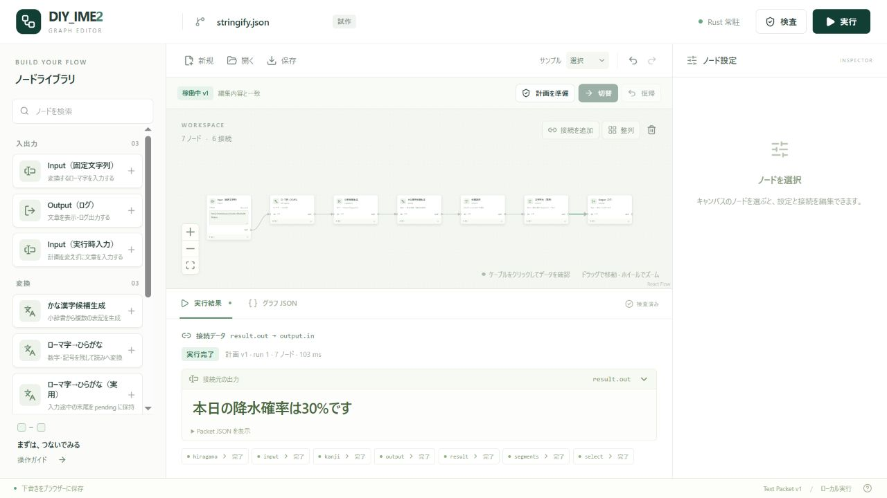
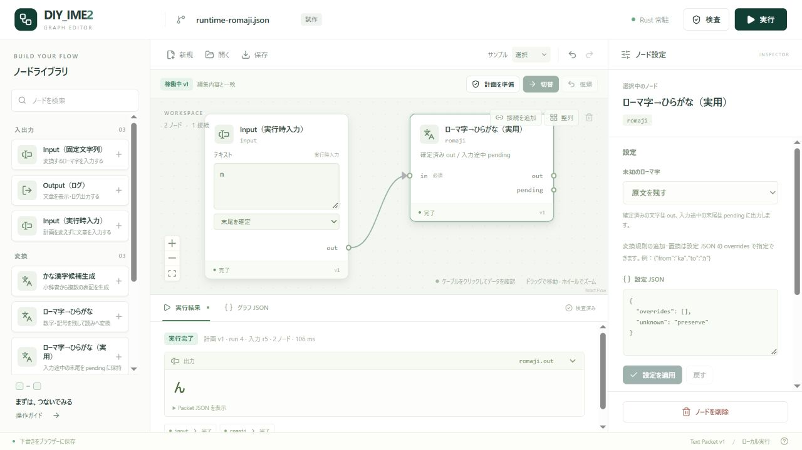
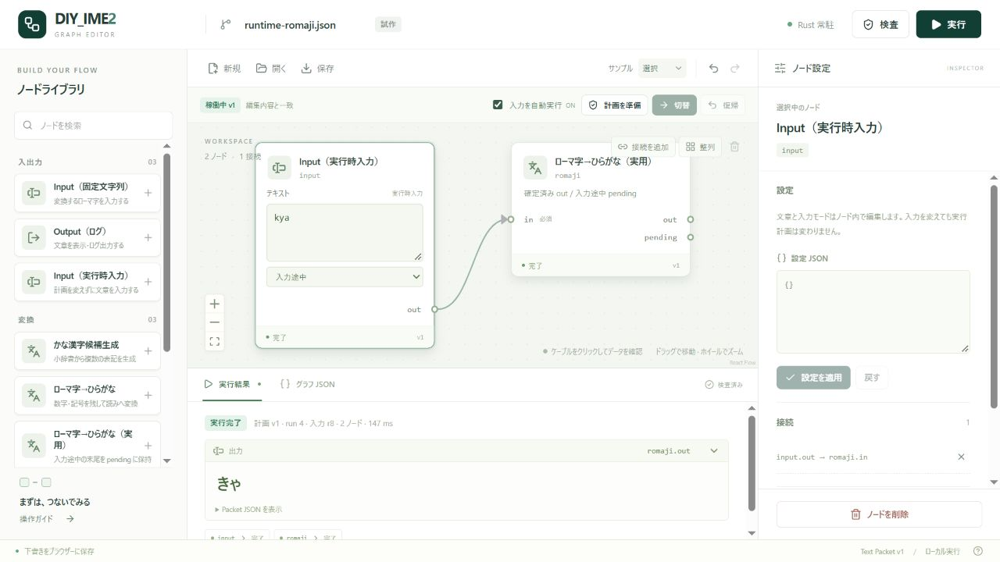
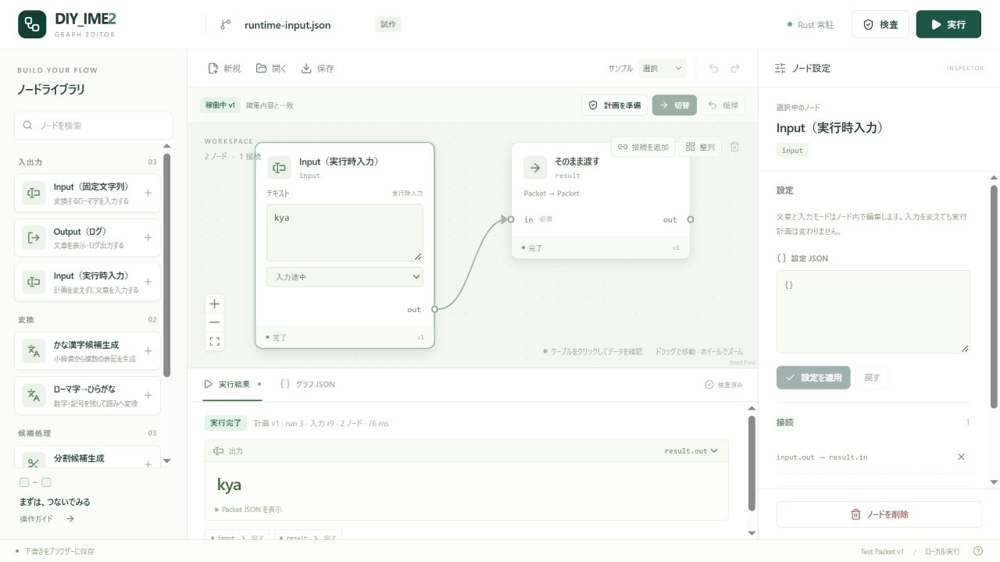
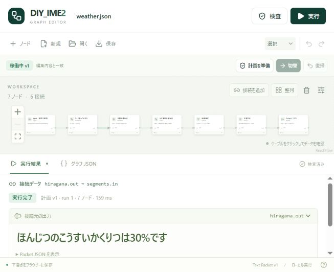
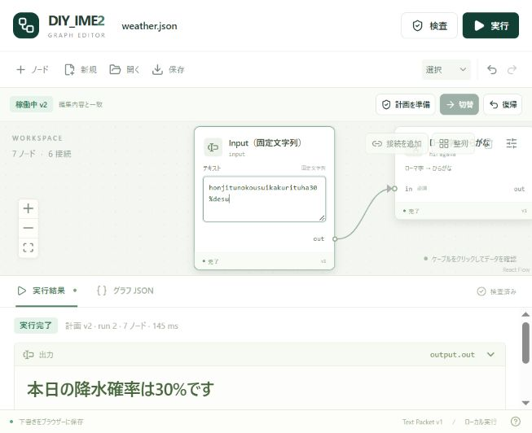

# DIY_IME2 グラフエディター

現在の入口は[Windows配布アプリ](../docs/security/windows-application-distribution.md)です。公式48パッケージと実行環境を同梱し、利用者によるGit/Cargo・再ビルドは不要です。画面は外部Wasm専用で、同期v2/v3への切替やNativeへの復帰はありません。

「実行Hostに接続」→サンプルを選ぶ→「グラフを確認」→実行・入力経路・辞書等の対象を選んで今回だけ/保存を許可→「このグラフへ切替」→入力して「承認済みグラフを実行」と操作します。通常の結果欄は要求した最終出力を優先します。途中の出力は出力欄・ケーブルで明示的に選べます。入力を保護すると旧結果を隠し、接続や許可の撤回・中止は実際の処理終了と区別して表示します。詳しくは[導入と実行の手順](../docs/security/wasm-execution-gui.md)を参照してください。

ソース開発でも通常のReact/Vite入口はexternal専用です。開発サーバーだけの起動は公式パッケージや隔離Hostの設定を代行しません。[Host設定](../docs/security/wasm-external-host.md)と[パッケージ管理設定](../docs/security/wasm-package-gui.md)は開発者用です。本体CLIの標準登録はsystem4だけで、内部の合成検査Hostは配布しません。

## 旧同期v2・明示v3画面の開発記録

以下の画像、同期/v3切替、旧起動例は分離前の履歴です。現在の通常画面の操作手順として使用しないでください。

ノードライブラリはIssue #1の7種・実用4種と、[実験35種](../docs/pre-ime-integration-2026-10-30.md)を表示する。実験ノードは検索して追加し、設定JSONを適用してから準備・切替・実行する。サンプル「Issue #1：降水確率」を選び、「計画を準備」→「切替」→「実行」で `本日の降水確率は30%です` を出力する。`hiragana.out`、`segments.out`、`kanji.out` などから途中の候補木を確認できる。「欠落入力：kaku なし」は読みを補わない負のテスト。旧デモ JSON の読込・実行は維持する。[各ノードの説明](../docs/initial-e2e.md) を参照。

TypeScript + React + React Flow のローカル試作。JSON グラフの表示・編集・保存と、Rust コアによる検査・実行・結果表示まで対応する。

「文字列化（実用）」は選択済みText・Sequenceを順番に連結する。サンプル「実用文字列化」を実行すると、`select.out` のSequenceが `result.out` のTextになる。ケーブルをクリックして両段階を確認できる。未選択Choiceはエラー、空Sequenceは空文字として扱う。[契約とサンプル](../examples/nodes/stringify/README.md)を参照。



「Input（実行時入力）」を追加した。サンプル「実行時入力を確認」を準備・切替すると、以後はノード内の文章・入力モードを変更して実行するだけで、同じ計画版を使える。サンプルは入力の受け渡しだけを確認し、ローマ字変換や新しい辞書仕様は含めない。

サンプル「実用ローマ字変換」は同じInputを実用ノードへ接続する。`k` / `ky` はpending、`kya` はoutに `きゃ` を出力する。`n` は「入力途中」ならpending、「末尾を確定」ならoutに `ん` を出す。結果欄の「表示する出力」で `romaji.out` / `romaji.pending` を確認できる。ノード設定で未知文字の扱いを選び、overridesは設定JSONで編集する。[仕様と設定例](../examples/nodes/romaji/README.md)を参照。



実行時の入力はグラフ設定・保存JSON・グラフUndo/Redoへ含めず、別の下書きとして保持する。再読み込み・再接続後も文章とモードを保持するが、稼働計画は自動で再適用しない。入力を変えると前の結果を「入力変更前の結果」と区別し、再実行で更新する。固定Inputの編集は従来どおり準備・切替が必要。

入力が長すぎる場合や読み取れない文字を含む場合は、送信前にエラーを表示する。その本文も下書きとして保持するため、再読み込み後に修正できる。修正するまで手動・自動実行を止め、本文を暗黙に置換・削除しない。

更新番号が上限（Number.MAX_SAFE_INTEGER）に達した場合は、「入力を保持して再接続」で本文・モードを残したまま編集を再開できる。新しい接続に成功した後だけ番号を付け直し、失敗時は元の下書きを保持する。グラフと編集履歴は残るが、稼働/準備/復帰用の計画と結果は新しい接続へ引き継がない。自動実行はOFFになり、再度「計画を準備」→「切替」が必要。実行中はこの復旧操作を無効にする。

計画バーの「入力を自動実行」をONにすると、実行時Inputの文章・モードを変更して200ms後に結果を更新する。初期値はOFF。「計画を準備」→「切替」は引き続き手動で行う。実行中の連続入力は最新の1件だけを次に処理し、古い応答を新しい結果として表示しない。未反映のグラフ編集、入力エラー、文字変換中、切断中は待機する。OFFで未送信の実行を取り消せ、手動の「実行」も使える。失敗した同じ入力を自動で再試行することはない。





## 非同期実行（v3）を選ぶ

既定は従来の同期v2。v3を使うときは、[共有Hostの13項目のresource policy](../docs/execution-http-v3.md)を明示したJSONファイルを用意し、起動するPowerShellで次を設定してから起動する。上限値は用途に応じて決め、製品の隠れた既定値で補わない。

```powershell
$env:DIY_IME_V3_RESOURCE_POLICY = 'C:\path\host-policy.json'
.\scripts\start-editor.ps1
```

上部の「非同期実行」を選び、「計画を準備」→「切替」→「実行」と操作する。「実行する出力」で要求するポートを選べる。実行期限は任意の正整数msで、空欄は期限を設けない。画面の定期照会・通信の応答監視は、仕事そのものの実行期限と区別する。

結果の受付・確定と、実際の仕事の終了は別に表示する。「取消」や期限切れ後も未終了の仕事があれば物理数を照会し続ける。接続故障・保持切れは終了確認と扱わない。故障後の再接続は空の計画で始まり、準備や実行を自動でやり直さない。「同期実行に戻る」は自分のv3 Sessionを閉じるが、共有Hostを強制終了しない。

v3では本文・入力モード・グラフの変更直後に旧Dataを隠し、一致する実行の検証済み出力だけを結果欄・ケーブルへ表示する。空文字列、NoOutput、エラーを区別し、復旧した出力でも元の失敗と復旧記録を残す。「入力を自動実行」は初期OFFで、ONなら200ms後に最新1件を実行する。失敗した開始要求を自動再送しない。

設定がなければhost-unconfiguredを表示する。v3選択中に旧v2の実行へ自動で流れない。グラフ・入力の下書きは保つが、同期/v3の稼働計画と結果は引き継がない。詳しい境界と検査は[v3画面接続](../docs/execution-ui-model.md)を参照。

## Windows で起動

リポジトリのルートで:

```powershell
.\scripts\start-editor.ps1
```

[http://127.0.0.1:5173/](http://127.0.0.1:5173/) をブラウザーで開く。終了は起動したターミナルで Ctrl+C。

スクリプトは対応する Node.js を探し、Cargo があれば Rust CLI をビルドする。依存パッケージが未導入・更新済みの場合は `npm ci` を実行する。この端末では通常の Node.js が古いため、Codex に同梱された Node.js を検出して利用する。システムの PATH や既定の Node.js は変更しない。

必要な Node.js は **22.22.2 以降の22系、24.15以降の24系、または26以降**。互換ランタイムが見つからない場合はインストール案内を表示する。Rust がない場合、変更されていないソースに対応するビルド済み `target/debug/diy-ime2.exe` を再利用できる。

手動で起動する場合:

```powershell
# Rust と対応 Node.js / npm を用意した環境で
cargo build --locked --bin diy-ime2
cd editor
npm ci
npm run dev
```

## 操作

1. 起動時は保存済みの下書き、なければ `weather.json` を表示する。
2. 左のノードライブラリから追加する。狭い画面では上部の「ノード」で開く。
3. ノードを選び、設定を変更して「設定を適用」。固定文字列、評価値の簡易フォームと設定 JSON を利用できる。旧デモの設定フォームも維持する。
   Input の固定文字列はノード内のテキスト欄から直接編集でき、この欄の変更はすぐにグラフと下書きへ反映される。右側の設定欄とも連動する。1回のフォーカス中の入力は1操作として取り消せる。入力欄では文字の選択・改行・スクロールができ、ノードのドラッグやキャンバス操作と干渉しない。稼働計画への反映には引き続き準備・切替を使う。
4. 出力ポートから入力ポートへドラッグするか「接続を追加」で接続する。
5. ノード・接続を選んで Delete で削除。選択ノードは設定パネルからも削除できる。接続は設定パネルの × からも削除できる。
6. 「計画を準備」で編集内容を検査して準備し、「切替」で稼働計画へ反映する。「実行」はその稼働版を使う。検査だけを行う場合は「検査」。
   実行後にケーブルをクリックすると、下の実行結果へ切り替わり、その接続元の出力を表示する。文字列・候補木・Packet JSON を確認できる。未実行・NoOutput・エラーも区別し、古い実行結果には「編集前の結果」と表示する。
7. 「保存」で CLI と共通の JSON をダウンロードし、「開く」で再読込できる。「グラフ JSON」タブから直接編集・適用することもできる。

Ctrl+Z / Ctrl+Shift+Z でグラフ操作を取り消し・やり直し、Ctrl+S で JSON 保存。配置変更はグラフの意味を変更しないため取り消し履歴に含めない。履歴は最大50操作。

グラフと配置は localStorage に下書き保存する。配置は JSON の規格へ追加しないので、JSON から開く場合は自動配置する。未適用の設定と未適用のグラフ JSON は下書き保存の対象外。必要な変更は適用してからファイル保存する。





### 計画の更新と復帰

- 編集内容と稼働中の計画は別に保持する。準備だけでは切り替わらない。
- 準備が失敗しても、旧計画と以前に準備した有効な計画を維持する。編集内容と準備済みのグラフが異なる間は「切替」を無効にする。
- 「実行」は未適用の設定や無効な編集があっても稼働中の計画を使える。結果に計画版と実行 ID を表示し、編集と異なる場合は参考結果として区別する。
- 「復帰」は直前の構成1件へ戻す。版番号は増え、編集中のグラフは保持する。「稼働中のグラフを開く」でその内容を編集画面へ読み込める。
- タブごとに別のセッションを使う。再読込・終了後の稼働計画は永続化しない。接続を失った場合は「再接続」後に準備・切替をやり直す。状態変更の自動再試行はしない。

## Rust との連携

Vite のローカル API が、固定の Rust 実行ファイルをシェルを介さず `diy-ime2 session` として起動し、JSON Lines プロトコル v2 で常駐 Engine を操作する。

| API | Rust / 処理 |
| --- | --- |
| GET `/api/nodes` | `diy-ime2 list-nodes` |
| GET `/api/examples/weather` / `weather-negative` / `hello` / `branch` | リポジトリの固定サンプルを読込 |
| POST `/api/sessions` | タブ専用の常駐セッションを作成 |
| GET / DELETE `/api/sessions/:id` | 状態取得 / セッション終了 |
| POST `/api/sessions/:id/validate` | 検査のみ（稼働・準備状態を変更しない） |
| POST `/api/sessions/:id/prepare` | 新しい計画を検証・準備 |
| POST `/api/sessions/:id/activate` | 準備識別子が一致する計画へ切替 |
| POST `/api/sessions/:id/run` | 指定した稼働版で実行 |
| POST `/api/sessions/:id/rollback` | 指定した稼働版から直前の構成へ復帰 |

`/api/graph/validate` と `/api/graph/run` の1回呼び出しも従来の互換 API として残す。エディターの実行操作には使用しない。

ノード宣言は Rust から取得し、必須入力・設定・循環・ポートの最終検査も Rust が行う。ブラウザーの接続チェックは補助。JavaScript 側で変換を代行したり成功を生成したりしない。

**試作上の境界:** Engine はタブを開いている間、同じプロセスで保持する。同期コマンドの間を切替境界とし、IME のキー入力経路・非同期ノード・ノード内部状態の移行はまだ扱わない。結果は要求・セッション・計画版・グラフの内容で照合し、古い応答を現在の成功表示に使わない。通信仕様は [常駐セッション](../docs/session-protocol.md) を参照。

開発サーバーは `127.0.0.1` のみ。API は異なる Origin を拒否し、要求1 MiB、応答8 MiB、コマンド10秒、常駐セッション4件、セッション内の未完了要求16件（送信中を含む）の上限を設ける。15分使われないセッションは終了し、画面は30秒ごとに状態を確認する。送信後の切断・時間超過は処理結果が不明なのでセッション全体を終了する。送信前の取消ではエンジンを維持する。

任意コマンドや任意ファイルパスを API から指定する機能はない。Rust をビルドし直す場合は、Windows の実行ファイルのロックを避けるため開発サーバーを終了してから起動し直す。認証付き公開サーバーや外部ノードを実行する基盤としては提供しない。

## 明示HTTP v3（画面は旧v2のまま）

全13項目のpolicyファイルを `DIY_IME_V3_RESOURCE_POLICY` に明示した場合だけ、別API `/api/v3/sessions` を有効にする。一つのbroker Hostを共有し、Sessionの切断・再接続で生存仕事の予算をリセットしない。既存画面はこのAPIへ暗黙に移行しない。[HTTP v3の設定・所有・検査](../docs/execution-http-v3.md)を参照。

## 検証

```powershell
# リポジトリのルートから起動スクリプトも含めて確認
.\scripts\start-editor.ps1 -Check

# または先にリポジトリのルートで検査Hostも準備する
cargo build --locked --bin diy-ime2 --example execution_broker_gate --example execution_transport_fixtures
cd editor
npm test
npm run build
```

テストはグラフ入出力・接続制約・履歴、実際の常駐 Rust と HTTP API の連携、準備と切替の分離、無効な編集後の継続、復帰、タブ分離、接続終了、古い応答の抑止を確認する。UI 単体テストでは React Flow の描画部分を置き換え、準備・切替・無効な編集・復帰の結果はブラウザーでも確認する。

`npm run build` は TypeScript の型検査と配布用フロントエンドの生成を行う。`npm run preview` では `127.0.0.1:5174` 上でビルド済み画面と同じ CLI ブリッジを利用できる。`dist/` だけを静的ホスティングしても Rust 連携は動かない。

React Flow は今回の試作で使用した。長期採用や外部公開 API の確定を意味しない。Tauri、Windows TSF、非同期・外部ノード、正式な設定 UI スキーマは後続段階。

長いグラフで入力欄が小さく見える場合は、ノードを選んでキャンバス上の「選択に拡大」を使う。既存のFit Viewで全体表示へ戻せる。倍率の変更はグラフの保存内容・履歴・稼働計画へ影響しない。

## 完全一致辞書を使う

サーバー起動前に、PowerShellで `$env:DIY_IME_RESOURCE_ROOT = (Resolve-Path .\examples\nodes\dictionary_exact).Path` を指定する（リポジトリルート基準）。サンプル「完全一致辞書（要フォルダー指定）」を読み込み、準備→切替→`kousui`入力→実行で「降水」になる。辞書Nodeのoutを選べば3候補が見える。未知語は原文を保持する。

ノード設定の「辞書ファイル」は許可フォルダーからの相対名。辞書変更の反映は明示的な準備→切替で行う。起動側のフォルダー指定を画面やJSONから新規許可することはできない。ルート未設定/読込失敗と未知語を区別する。[詳しい手順・制限](../examples/nodes/dictionary_exact/README.md)、[Host取得境界](../docs/host-resources.md)を参照。明示v3も同じ起動環境の辞書を使う。

配布版は別工程の `npm run build:distribution` で静的画面とサーバーを生成し、外部Wasm実行で起動します。利用者向けの本体・実行環境同梱は [Windows配布版](../docs/security/windows-application-distribution.md) を参照してください。従来の開発用起動方法から、配布版の隔離処理が自動的に旧実行へ戻ることはありません。
